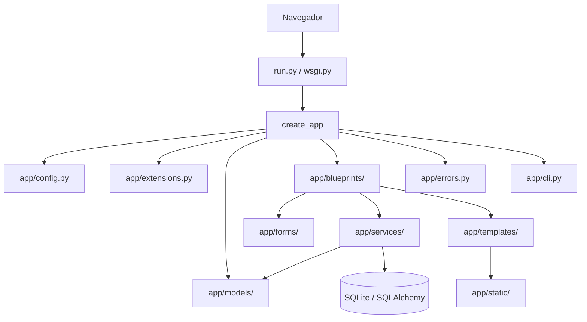

# Arquitetura

## Objetivo

Descrever como o Agenda-Senac é montado, quais camadas existem e como uma requisição percorre o sistema. Veja também [Configuração](CONFIGURACAO.md), [Rotas](ROTAS.md) e [Serviços](SERVICOS.md).

## Visão geral

O projeto é um **monólito modular Flask** organizado com Application Factory. Não há frontend separado: templates Jinja2 são renderizados no servidor e incrementados por CSS/JavaScript estáticos.



### Stack fixada

| Camada | Tecnologia | Arquivo |
| --- | --- | --- |
| Servidor | Flask 3.1.3 | `requirements.txt` |
| ORM | Flask-SQLAlchemy 3.1.1 / SQLAlchemy 2.x | `app/extensions.py` |
| Migrações | Flask-Migrate 4.1.0 / Alembic | `migrations/` |
| Autenticação | Flask-Login 0.6.3 | `app/extensions.py` |
| Formulários | Flask-WTF 1.3.0 / WTForms 3.3.2 | `app/forms/` |
| Banco padrão | SQLite em `instance/senac_cursos.db` | `app/config.py` |
| Planilha | openpyxl 3.1.5 | `app/services/exportacao_service.py` |
| Interface | Tabler 1.7.5 + Bootstrap 5.3.9 JS + ícones Bootstrap | `app/templates/base.html` |

## Application Factory

Implementação: `app/__init__.py:16-43`.

Ordem exata de inicialização:

1. `Flask(__name__, instance_relative_config=True)`.
2. `configuracao = get_config(config_name)`.
3. `app.config.from_object(configuracao)`.
4. Validação de produção: `SECRET_KEY` não pode ser um placeholder conhecido.
5. Criação da pasta `instance/`.
6. `_registrar_extensoes(app)`.
7. `_registrar_modelos()` via `from app import models`.
8. `_registrar_carregador_de_usuario()`.
9. `register_blueprints(app)`.
10. `register_error_handlers(app)`.
11. `registrar_comandos(app)`.
12. `_registrar_contexto_do_shell(app)`.
13. Retorno do `app`.

### Extensões

`app/extensions.py:16-35` mantém as instâncias globais:

| Objeto | Finalidade |
| --- | --- |
| `db` | SQLAlchemy / sessão |
| `migrate` | Alembic via Flask-Migrate |
| `login_manager` | Sessão de administrador |
| `csrf` | Proteção CSRF global |

`login_manager` configura `login_view = "auth.login"`, mensagem de login e `session_protection = "strong"`. Um listener global em `Engine` ativa `PRAGMA foreign_keys=ON` para conexões SQLite.

### Carregador de usuário

`carregar_administrador(usuario_id: str)` converte o ID para `int` e retorna `db.session.get(Administrador, identificador)`. Valores inválidos retornam `None`.

### Contexto de shell

`flask shell` recebe `db`, `Administrador`, `Curso`, `Inscricao` e `Turma` prontos para uso (`app/__init__.py:70-81`).

## Estrutura de pastas

```text
.
├── app/
│   ├── __init__.py              # Application Factory
│   ├── cli.py                   # criar-admin, seed-demo
│   ├── config.py                # Development/Testing/Production
│   ├── contracts.py             # Protocolos de integração
│   ├── errors.py                # 400/403/404/500/CSRF
│   ├── extensions.py            # db, migrate, login_manager, csrf
│   ├── blueprints/
│   │   ├── main/                # home
│   │   ├── catalogo/            # /cursos
│   │   ├── inscricoes/          # /inscricoes
│   │   ├── auth/                # /auth
│   │   └── admin/               # /admin
│   ├── forms/                   # WTForms
│   ├── models/                  # SQLAlchemy + enums
│   ├── services/                # regras de negócio
│   ├── templates/               # layouts, páginas e componentes
│   └── static/                  # css, js, uploads
├── docs/                        # esta documentação
├── migrations/                  # Alembic
├── tests/                       # pytest
├── run.py                       # entrypoint de desenvolvimento
└── wsgi.py                      # entrypoint WSGI de produção
```

## Blueprints

Registro central em `app/blueprints/__init__.py:13-25`.

| Blueprint | Prefixo | Responsabilidade |
| --- | --- | --- |
| `main` | nenhum | Página inicial |
| `catalogo` | `/cursos` | Catálogo e detalhe públicos |
| `inscricoes` | `/inscricoes` | Pré-inscrição e comprovante |
| `auth` | `/auth` | Login e logout |
| `admin` | `/admin` | Painel administrativo |

A tabela completa de endpoints está em [Rotas](ROTAS.md).

## Ciclo de vida de uma requisição

1. `app/config.py` carrega `.env` no import do módulo.
2. `create_app()` monta a aplicação conforme descrito acima.
3. Werkzeug resolve a URL para um dos 25 endpoints (24 da aplicação + `static`).
4. `before_request` global do CSRF protege `POST`, `PUT`, `DELETE` e `PATCH`.
5. `before_request` do blueprint `admin` exige login.
6. A view chama formulários e serviços.
7. Serviços validam regras e persistem via `db.session`.
8. Templates renderizam dados, flashes e componentes.
9. `after_request` do Flask-Login atualiza cookies quando aplicável.
10. `teardown_appcontext` do Flask-SQLAlchemy remove a sessão.
11. Erros caem nos handlers de `app/errors.py`; `500` faz rollback e loga a exceção.

Não há `context_processor` customizado, hooks de CORS nem `after_request` próprio. `config`, `request`, `current_user`, `url_for`, `csrf_token()` e `get_flashed_messages()` ficam disponíveis nos templates por padrão ou via extensões.

## Contratos entre módulos

`app/contracts.py` define `typing.Protocol` para desacoplar consumidores:

| Protocolo | Métodos |
| --- | --- |
| `CatalogoService` | `listar_cursos_publicos`, `obter_curso` |
| `InscricaoService` | `criar_pre_inscricao`, `listar_inscricoes`, `alterar_status` |
| `AutenticacaoService` | `autenticar` |

São documentação de tipo em tempo de desenvolvimento; não são aplicados em runtime. As implementações concretas ampliam as assinaturas, por exemplo `criar_pre_inscricao(..., turma_id=...)` e `listar_inscricoes(..., termo=...)`.

## Decisões de design

- **Monólito modular**: simplifica deploy e preserva transações locais em SQLite.
- **Serviços como donos das regras**: rotas ficam finas e validações reutilizáveis.
- **Modelos com propriedades de domínio**: `vagas_disponiveis`, `disponivel`, `protocolo` e `situacao` evitam duplicar regras em templates.
- **Templates com layouts separados**: `base.html` para o público e `admin_base.html` para o painel.
- **Componentes Jinja**: macros em `components/ui.html` reduzem repetição; ver [Interface](INTERFACE.md).
- **CDN versionado**: evita quebras silenciosas de bibliotecas visuais.
- **Histórico preservado**: cursos/turmas com inscrições são arquivados, não excluídos.

## Pontos de extensão

| Necessidade | Local indicado |
| --- | --- |
| Nova rota pública | blueprint correspondente ou novo blueprint registrado em `app/blueprints/__init__.py` |
| Nova regra de negócio | `app/services/` |
| Nova validação de entrada | `app/forms/` |
| Nova coluna | modelo + migração Alembic + testes |
| Novo componente visual | `app/templates/components/` e `app/static/css/style.css` |
| Novo comando operacional | `app/cli.py` |

## Leitura complementar

- [Configuração](CONFIGURACAO.md)
- [Banco de dados](BANCO_DE_DADOS.md)
- [Rotas](ROTAS.md)
- [Interface](INTERFACE.md)
