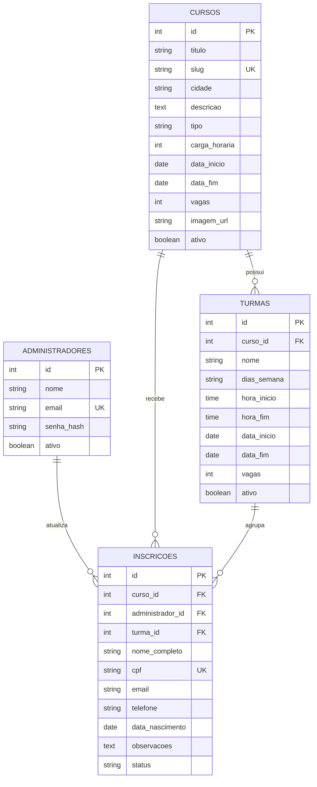

# Banco de dados

## Objetivo

Documentar o esquema relacional, constraints, índices, histórico de migrações e rotinas de manutenção do banco. Veja também [Modelos](MODELOS.md), [Serviços](SERVICOS.md) e [Configuração](CONFIGURACAO.md).

## Visão geral

O banco padrão é SQLite em `instance/senac_cursos.db`, configurado por `DATABASE_URL`. O projeto usa Alembic via Flask-Migrate.

`app/extensions.py:27-35` ativa `PRAGMA foreign_keys=ON` para conexões SQLite. Isso é essencial para que `ON DELETE RESTRICT` seja respeitado.

## Modelo entidade-relacionamento



## Tabelas

### `administradores`

| Coluna | Tipo | Restrições |
| --- | --- | --- |
| `id` | Integer | PK |
| `nome` | String(120) | NOT NULL |
| `email` | String(255) | UNIQUE, NOT NULL, indexado |
| `senha_hash` | String(255) | NOT NULL |
| `ativo` | Boolean | NOT NULL, padrão `True` |
| `criado_em`, `atualizado_em` | DateTime(timezone=True) | NOT NULL |

Não existe constraint de banco garantindo um único administrador. A regra está no CLI `criar-admin` (`app/cli.py:83-99`).

### `cursos`

| Coluna | Tipo | Restrições |
| --- | --- | --- |
| `id` | Integer | PK |
| `titulo` | String(150) | NOT NULL |
| `slug` | String(180) | UNIQUE, anulável, indexado |
| `cidade` | String(100) | NOT NULL, padrão `Sobral`, indexado |
| `descricao` | Text | NOT NULL, padrão `""` |
| `tipo` | Enum(`TipoCurso`) | NOT NULL, indexado; gravado como `gratuito` |
| `link_externo` | String(500) | anulável, legado |
| `valor` | Numeric(10, 2) | anulável, legado |
| `carga_horaria` | Integer | anulável, `> 0` |
| `data_inicio`, `data_fim` | Date | anuláveis, `data_fim >= data_inicio` |
| `vagas` | Integer | anulável, `>= 0`; `NULL` = ilimitado |
| `imagem_url` | String(500) | anulável |
| `ativo` | Boolean | NOT NULL, padrão `True`, indexado |

Constraints:

| Nome | Regra |
| --- | --- |
| `ck_cursos_tipo_valido` | `tipo IN ('pago', 'gratuito')` — resíduo legado |
| `ck_cursos_link_externo_por_tipo` | curso gratuito não pode ter `link_externo` |
| `ck_cursos_valor_nao_negativo` | `valor IS NULL OR valor >= 0` |
| `ck_cursos_vagas_nao_negativas` | `vagas IS NULL OR vagas >= 0` |
| `ck_cursos_carga_horaria_positiva` | `carga_horaria IS NULL OR carga_horaria > 0` |
| `ck_cursos_periodo_valido` | `data_fim IS NULL OR data_inicio IS NULL OR data_fim >= data_inicio` |

Índice composto: `ix_cursos_publicacao (ativo, tipo, cidade)`.

### `turmas`

| Coluna | Tipo | Restrições |
| --- | --- | --- |
| `id` | Integer | PK |
| `curso_id` | Integer | FK `cursos.id`, `ON DELETE CASCADE`, NOT NULL, indexado |
| `nome` | String(100) | NOT NULL |
| `dias_semana` | String(120) | anulável |
| `hora_inicio`, `hora_fim` | Time | anuláveis, `hora_fim > hora_inicio` |
| `data_inicio`, `data_fim` | Date | anuláveis, `data_fim >= data_inicio` |
| `vagas` | Integer | anulável, `>= 0`; `NULL` = ilimitado |
| `ativo` | Boolean | NOT NULL, padrão `True`, indexado |

Índice composto: `ix_turmas_curso_ativo (curso_id, ativo)`.

### `inscricoes`

| Coluna | Tipo | Restrições |
| --- | --- | --- |
| `id` | Integer | PK |
| `curso_id` | Integer | FK `cursos.id`, `ON DELETE RESTRICT`, NOT NULL, indexado |
| `administrador_id` | Integer | FK `administradores.id`, `ON DELETE SET NULL`, anulável, indexado |
| `turma_id` | Integer | FK `turmas.id`, `ON DELETE SET NULL`, anulável, indexado |
| `nome_completo` | String(150) | NOT NULL |
| `cpf` | String(14) | anulável, **UNIQUE global** |
| `email` | String(255) | anulável, indexado |
| `telefone` | String(20) | anulável |
| `data_nascimento` | Date | anulável |
| `observacoes` | Text | anulável |
| `status` | Enum(`StatusInscricao`) | NOT NULL, padrão `recebida`, indexado |

Índice composto: `ix_inscricoes_curso_status (curso_id, status)`.

## Regras refletidas no banco

- Um CPF só pode existir uma vez em todo o sistema (`uq_inscricoes_cpf`).
- Curso com inscrição não pode ser excluído: FK `RESTRICT` + bloqueio no serviço.
- Turma com inscrição não deve ser excluída: bloqueio no serviço; a FK usa `SET NULL` para preservar histórico.
- Inscrição cancelada continua no banco, mas não ocupa vaga.
- Status é gravado pelo valor do enum, não pelo nome do membro.
- Campos legados de curso pago permanecem na tabela, mas o serviço sempre força `tipo = gratuito`, `link_externo = NULL` e `valor = NULL`.

## Histórico de migrações

Cadeia atual:

```text
e20f62e9afcd -> b7c1d2e3f4a5 -> c3d4e5f6a7b8 -> f6a7b8c9d0e1 -> a2b3c4d5e6f7
```

| Revisão | Arquivo | Efeito |
| --- | --- | --- |
| `e20f62e9afcd` | `migrations/versions/e20f62e9afcd_estrutura_inicial.py` | Cria `administradores`, `cursos`, `inscricoes`; unicidade de CPF por curso; status antigos |
| `b7c1d2e3f4a5` | `migrations/versions/b7c1d2e3f4a5_preserva_historico_e_revisa_status.py` | Converte status antigos, troca FK de curso para `RESTRICT`, torna CPF/e-mail anuláveis |
| `c3d4e5f6a7b8` | `migrations/versions/c3d4e5f6a7b8_modulo_de_cursos_e_turmas.py` | Cria `turmas`, adiciona `inscricoes.turma_id`, índices e constraints |
| `f6a7b8c9d0e1` | `migrations/versions/f6a7b8c9d0e1_cidade_sobral_e_remove_cursos_pagos.py` | Exclui cursos pagos, adiciona `cursos.cidade` e `ix_cursos_cidade` |
| `a2b3c4d5e6f7` | `migrations/versions/a2b3c4d5e6f7_cpf_unico_global.py` | Normaliza CPFs, remove duplicados e cria unicidade global |

O downgrade de `f6a7b8c9d0e1` **não restaura** cursos pagos excluídos.

## Comandos

Aplicar migrações:

```bash
flask --app run.py db upgrade
```

Criar nova migração após alterar um modelo:

```bash
flask --app run.py db migrate -m "descrição da mudança"
flask --app run.py db upgrade
```

Ver histórico:

```bash
flask --app run.py db history
flask --app run.py db current
```

Reverter uma revisão:

```bash
flask --app run.py db downgrade <revisao>
```

## Backup SQLite

Antes de migrations ou mudanças em massa:

```bash
cp instance/senac_cursos.db instance/senac_cursos.db.bak
```

Para restore, pare a aplicação, substitua o arquivo e reinicie. Em produção com SQLite, garanta também backup do diário WAL, se ativo.

## Observações de manutenção

- O modelo declara `ix_cursos_publicacao (ativo, tipo, cidade)`, mas a migração `f6a7b8c9d0e1` criou `ix_cursos_cidade` separada. Um `flask db migrate` pode gerar uma alteração espúria até que essa divergência seja corrigida.
- `ck_cursos_tipo_valido` ainda aceita `pago` no banco, embora o enum só tenha `gratuito`. Inserções via SQL direto podem criar linhas que o SQLAlchemy não consegue carregar.
- Listagens não paginam. Monitore crescimento de `inscricoes`.
- A verificação de CPF usa comparação exata com CPF formatado. Registros legados não normalizados pela migração podem não ser detectados como duplicados.

## Leitura complementar

- [Modelos](MODELOS.md)
- [Serviços](SERVICOS.md)
- [Fluxos de negócio](FLUXOS_DE_NEGOCIO.md)
- [Manutenção](MANUTENCAO.md)
