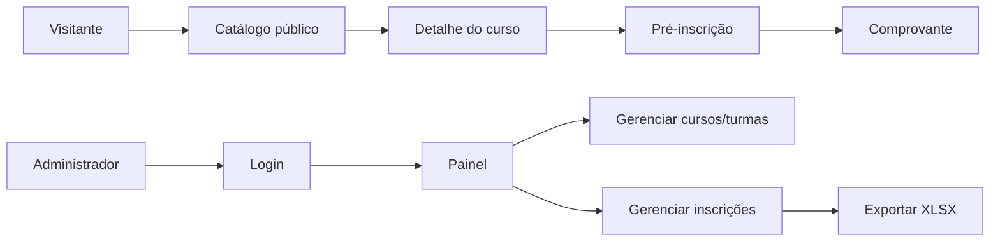
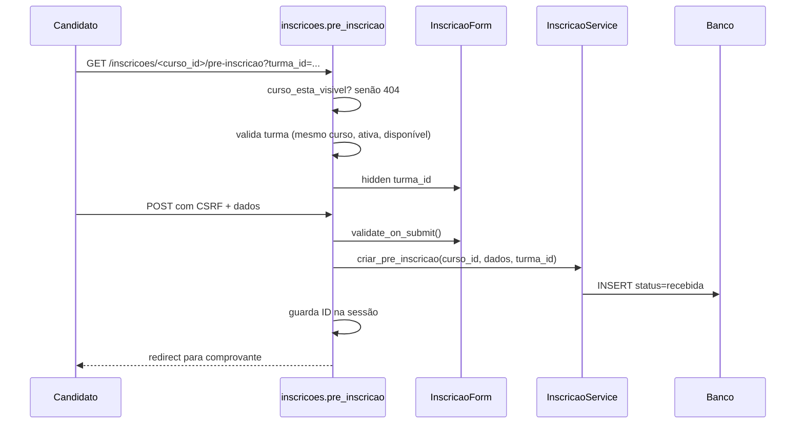
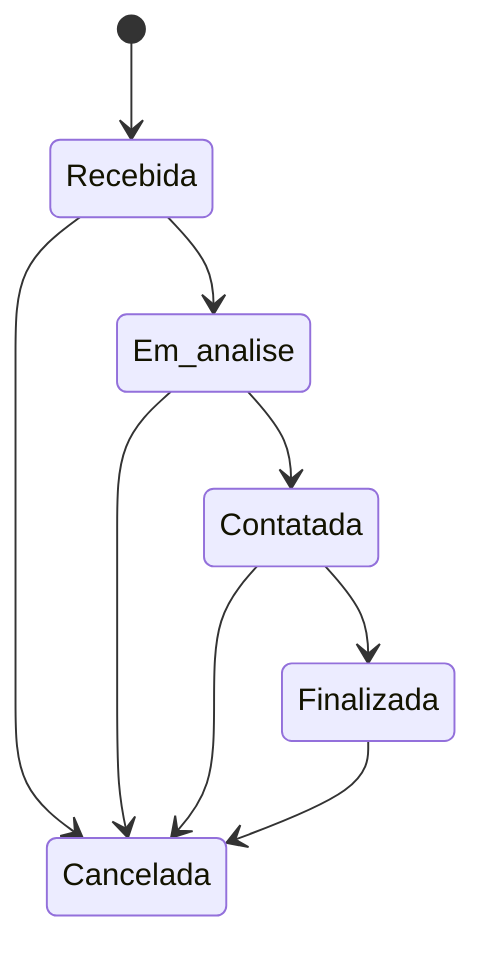
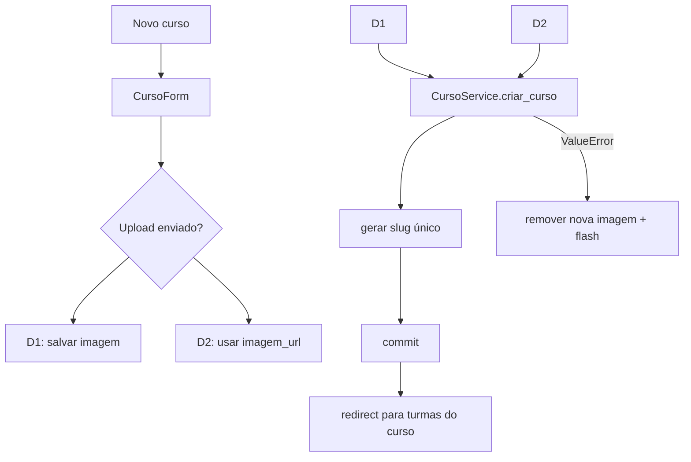

# Fluxos de negócio

## Objetivo

Descrever as jornadas completas do sistema e os invariantes que devem ser preservados. Veja também [Serviços](SERVICOS.md), [Rotas](ROTAS.md) e [Modelos](MODELOS.md).

## Visão geral

## Fluxo 1 — Catálogo público

1. `main.index` busca `CursoService.listar_cursos_publicos()` e mostra até 6 cursos.
2. `catalogo.listar` aplica o mesmo filtro, com busca opcional `q`.
3. `catalogo.detalhe` exige `curso_esta_visivel(curso)`; caso contrário, `404`.
4. O detalhe carrega `listar_turmas(curso_id, apenas_ativas=True)`.
5. Cards e detalhe mostram `vagas_disponiveis`, `possui_vagas` e `aceita_pre_inscricao`.

Filtro de visibilidade:

- `ativo is not False`;
- `tipo is TipoCurso.GRATUITO`;
- `cidade == CIDADE_PADRAO`.

`curso_esta_visivel()` usa `ativo is not False`, portanto um objeto recém-criado ainda sem flush é considerado visível.

## Fluxo 2 — Pré-inscrição

Regras:

- turma inválida → `404`;
- turma sem vaga → aviso `warning`, mas o formulário ainda é exibido;
- CPF duplicado → `ValueError` do serviço, exibido como flash `error`;
- aceite de dados é obrigatório;
- após sucesso, a sessão guarda os 10 últimos IDs e `ultima_inscricao_id`.

### Comprovante

`inscricoes.confirmacao` permite acesso quando:

- usuário autenticado (administrador); ou
- ID da inscrição está em `session["inscricoes_ids"]`.

Caso contrário, `404`. O protocolo exibido é `INS-{ano}-{id:05d}`.

## Fluxo 3 — Situação da inscrição

O diagrama mostra o fluxo esperado. Técnicamente, `alterar_status()` aceita qualquer transição entre os cinco membros de `StatusInscricao`.

Ao alterar:

1. `admin.alterar_status_inscricao` lê `status` do POST;
2. `InscricaoService.alterar_status()` converte e valida;
3. grava `administrador_id = current_user.id`;
4. mantém `q`, `status` e `curso_id` na URL de retorno;
5. exibe flash de sucesso ou erro.

`cancelada` é a única situação que não conta como vaga ocupada em `Curso.vagas_ocupadas` e `Turma.vagas_ocupadas`.

## Fluxo 4 — Cadastro de curso

Regras importantes:

- todo curso gravado pelo painel é `gratuito`, sem `valor` e sem `link_externo`;
- cidade vem de `CIDADE_PADRAO` no GET e pode ser alterada no formulário;
- slug é gerado quando vazio e recebe sufixo numérico em caso de conflito;
- upload inválido adiciona erro ao campo `imagem_upload`;
- após criar, o fluxo leva direto ao gerenciamento de turmas.

## Fluxo 5 — Gerenciamento de turmas

1. `admin.turmas_do_curso` lista todas as turmas, ativas e inativas.
2. `admin.nova_turma`/`admin.editar_turma` usam `TurmaForm`.
3. `CursoService` valida horário, datas e vagas.
4. Ativar/desativar altera apenas `ativo`.
5. Excluir só é permitido sem inscrições vinculadas.

Disponibilidade pública de uma turma (`Turma.disponivel`) exige:

- `turma.ativo is not False`;
- curso ativo, ou curso ainda não carregado;
- `turma.tem_vagas` (`vagas is None` ou `vagas_disponiveis > 0`).

## Fluxo 6 — Arquivamento

Curso e turma com histórico não devem ser excluídos.

| Situação | Ação correta | Efeito |
| --- | --- | --- |
| Curso com inscrições | `admin.desativar_curso` | some do catálogo; histórico permanece |
| Turma com inscrições | `admin.desativar_turma` | não aparece como disponível; histórico permanece |
| Curso sem inscrições | `admin.excluir_curso` | remove curso e turmas; imagem é removida |
| Turma sem inscrições | `admin.excluir_turma` | remove turma |

Tentativa de exclusão com inscrições gera flash de erro, sem propagar exceção.

## Fluxo 7 — Exportação

1. Usuário filtra `/admin/inscricoes` por `q`, `status` e `curso_id`.
2. Link “Exportar para Excel” repassa os mesmos parâmetros.
3. `admin.exportar_inscricoes` chama `listar_inscricoes()` com os filtros.
4. `gerar_planilha_inscricoes()` monta o XLSX.
5. Resposta `Content-Disposition: attachment; filename="inscricoes-AAAA-MM-DD.xlsx"`.

Valores que começam com `=`, `+`, `-` ou `@` são forçados como texto para evitar injeção de fórmulas.

## Invariantes resumidos

- Somente cursos ativos, gratuitos e da cidade configurada aparecem no catálogo.
- Um CPF possui no máximo uma inscrição no sistema.
- Inscrição começa em `recebida`.
- Inscrições `cancelada` não entram em `vagas_ocupadas`, portanto não ocupam vaga.
- Curso/turma com inscrição são arquivados, não excluídos.
- Alteração de status registra o administrador responsável.
- Comprovante é privado por sessão ou admin.
- Exportação reproduz exatamente os filtros da tela.
- Toda alteração via POST exige CSRF válido.

## Leitura complementar

- [Serviços](SERVICOS.md)
- [Rotas](ROTAS.md)
- [Segurança](SEGURANCA.md)
