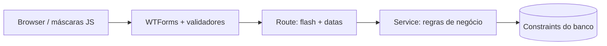

# Formulários

## Objetivo

Documentar os formulários WTForms, validadores e mensagens exibidas ao usuário. Veja também [Serviços](SERVICOS.md), [Interface](INTERFACE.md) e [Segurança](SEGURANCA.md).

## Visão geral

Todos os formulários herdam `FlaskForm`, portanto recebem proteção CSRF global (`app/extensions.py`). Nos templates, o token é renderizado por `form.hidden_tag()` ou por `<input type="hidden" name="csrf_token" value="{{ csrf_token() }}">`.

| Arquivo | Formulário | Uso |
| --- | --- | --- |
| `app/forms/auth.py` | `LoginForm` | `/auth/login` |
| `app/forms/inscricao.py` | `InscricaoForm` | `/inscricoes/<curso_id>/pre-inscricao` |
| `app/forms/curso.py` | `CursoForm` | Novo curso e edição de curso |
| `app/forms/curso.py` | `TurmaForm` | Nova turma e edição de turma |

Não há formulário para alteração de status: a action usa um `<select name="status">` com token CSRF manual em `app/templates/admin/inscricoes.html`.

## `LoginForm`

Arquivo: `app/forms/auth.py:10-25`.

| Campo | Tipo | Validação |
| --- | --- | --- |
| `email` | `StringField` | filtro `strip().lower()`, `DataRequired`, `Email`, `Length(max=255)` |
| `senha` | `PasswordField` | `DataRequired` |

Autenticação real é feita por `AutenticacaoService.autenticar()`, não pelo formulário.

## `InscricaoForm`

Arquivo: `app/forms/inscricao.py:42-110`.

| Campo | Tipo | Validação |
| --- | --- | --- |
| `nome_completo` | `StringField` | `DataRequired`, `Length(3-150)` |
| `cpf` | `StringField` | `DataRequired`, `Length(max=14)` + `validate_cpf` |
| `email` | `StringField` | `DataRequired`, `Email`, `Length(max=255)` |
| `telefone` | `StringField` | `DataRequired`, `Length(max=20)` + `validate_telefone` |
| `data_nascimento` | `DateField` | `Optional` + `validate_data_nascimento` |
| `observacoes` | `TextAreaField` | `Optional`, `Length(max=1000)` |
| `aceite` | `BooleanField` | `DataRequired` — autorização de tratamento de dados |
| `turma_id` | `HiddenField` | preenchido pela query string ou pelo POST |

### Validações customizadas

- `validate_cpf()` usa `cpf_e_valido()`; rejeita CPFs com menos de 11 dígitos, todos iguais ou com dígitos verificadores incorretos.
- `validate_telefone()` exige 10 ou 11 dígitos após remover a máscara.
- `validate_data_nascimento()` rejeita datas futuras.

### Helpers de CPF

| Função | Comportamento |
| --- | --- |
| `somente_digitos(valor)` | `re.sub(r"\D", "", valor or "")` |
| `cpf_e_valido(cpf)` | valida os dois dígitos verificadores |
| `formatar_cpf(cpf)` | devolve `000.000.000-00` |

A rota formata o CPF antes de montar o `dados` enviado ao serviço; o serviço volta a normalizar e validar. Essa duplicação é intencional: protege tanto a interface quanto chamadas diretas ao serviço.

## `ImagemUrl`

Validador customizado em `app/forms/curso.py:29-52`.

Aceita:

- URLs `http://` ou `https://` com `netloc`;
- caminhos locais que comecem com `UPLOAD_URL_PREFIX` (`/static/uploads/` por padrão), sem `/` ou `\` no nome do arquivo.

Rejeita qualquer outro valor, incluindo `javascript:`, `data:` e caminhos absolutos do sistema. Valor vazio é ignorado.

## `CursoForm`

Arquivo: `app/forms/curso.py:55-154`.

| Campo | Tipo | Validação principal |
| --- | --- | --- |
| `titulo` | `StringField` | obrigatório, máx. 150 |
| `slug` | `StringField` | opcional, máx. 180 |
| `descricao` | `TextAreaField` | obrigatória |
| `cidade` | `StringField` | obrigatória, máx. 100; default `Sobral` |
| `carga_horaria` | `IntegerField` | opcional, `>= 1` |
| `data_inicio` | `DateField` | opcional |
| `data_fim` | `DateField` | opcional + `validate_data_fim` |
| `vagas` | `IntegerField` | opcional, `>= 0` |
| `imagem_url` | `StringField` | opcional + `ImagemUrl()` + máx. 500 |
| `imagem_upload` | `FileField` | opcional + `FileAllowed(EXTENSOES_IMAGEM_PERMITIDAS)` |
| `ativo` | `BooleanField` | padrão `True` |

`validate_data_fim()` impede que a data final seja anterior à inicial.

O upload é processado no route (`_salvar_curso`), não no formulário. A imagem antiga é removida quando substituída; se a persistência falhar, a nova imagem é removida.

## `TurmaForm`

Arquivo: `app/forms/curso.py:157-232`.

| Campo | Tipo | Validação principal |
| --- | --- | --- |
| `nome` | `StringField` | obrigatório, máx. 100 |
| `dias_semana` | `StringField` | opcional, máx. 120 |
| `hora_inicio` | `TimeField` | opcional |
| `hora_fim` | `TimeField` | opcional + `validate_hora_fim` |
| `data_inicio` | `DateField` | opcional |
| `data_fim` | `DateField` | opcional + `validate_data_fim` |
| `vagas` | `IntegerField` | opcional, `>= 0` |
| `ativo` | `BooleanField` | padrão `True` |

Validações cruzadas:

- `validate_hora_inicio()` exige início e fim juntos;
- `validate_hora_fim()` exige `hora_fim > hora_inicio`;
- `validate_data_fim()` exige `data_fim >= data_inicio`.

## Renderização

A macro `field()` em `app/templates/components/ui.html:15-42` padroniza a saída:

- adiciona `form-control` ou `form-select`;
- marca `is-invalid` quando há erros;
- define `required` e `aria-invalid`/`aria-describedby` quando aplicável;
- renderiza ajuda e mensagens de erro com IDs previsíveis.

`checkbox_field()` faz o equivalente para `BooleanField`.

Exemplo:

```jinja

{{ field(formulario.titulo) }}
{{ checkbox_field(formulario.ativo) }}
```

## Camadas de validação



- JavaScript (`app/static/js/main.js`) formata CPF e telefone, mas **não** é a validação definitiva.
- WTForms valida formato e presença.
- Serviços validam existência de curso/turma, disponibilidade, CPF duplicado e regras de datas/valores.
- O banco é a última barreira: FK, `UNIQUE`, checks e `NOT NULL`.

## Leitura complementar

- [Serviços](SERVICOS.md)
- [Interface](INTERFACE.md)
- [Segurança](SEGURANCA.md)
